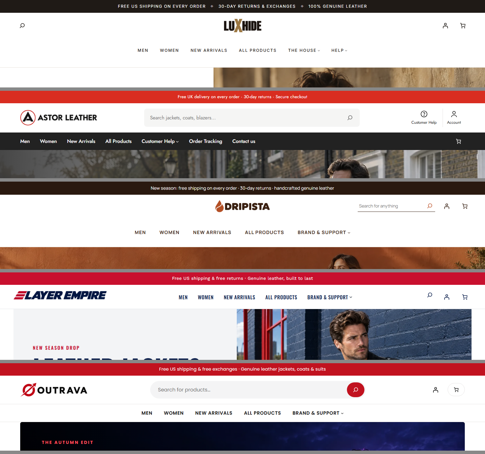

# WooCommerce Multi-Store Build: 5 Branded Leather-Jacket Stores on One Server

> **Case study.** This repository documents the approach and results only. The theme code, server scripts and store data are private and are not included.

## Overview

I built five separate WooCommerce stores for one leather-jacket business, all on a single shared Cloudways server that also runs the owner's main live store. The brief was simple: each store needs its own brand and look, and none of them may slow the server down.

| Store | Look |
|---|---|
| LuxHide | Black and white, centred logo, editorial hero (site 1, the template) |
| Astor Leather | UK store (GBP), red offer bar, dark menu bar, wide search |
| Dripista | Warm umber palette, centred caps menu, feature grids |
| Layer Empire | Navy and red, round category circles, split hero |
| Outrava | Dark hero, rounded search, red accents |

The first store, LuxHide, was built by hand and signed off by the owner. The other four reuse its structure with a new palette, fonts, layout and wording.

## How the stores are built

- **Light by design:** a child theme of WordPress's Twenty Twenty-Five block theme for each brand. There's no page builder, only about 3 plugins, self-hosted fonts and WebP images.
- **Remote build:** everything is done over SSH with WP-CLI (themes, pages, menus, products, settings), so all five stores are scripted and repeatable.
- **Shop structure:** Men and Women categories plus two automatic links, *New Arrivals* (newest first) and *All Products*. New products appear in the right place with no manual sorting.
- **Product page:**
  - Square product photos with a full-screen viewer.
  - One size-chart popup with Men/Women tabs, which opens on the right tab for the product.
  - Size buttons, and the description under Add to Cart.
  - Add to Cart goes straight to the cart.
- **Policy pages per brand:** shipping, returns, refund, privacy, terms, FAQ, order tracking and contact. Each store has its own wording and country-aware details (US Eastern time for the US stores, UK time and GBP for Astor).
- **Brand assets:** AI-generated logos and favicons for each brand, in header, footer, phone menu and white versions.

## Phone and tablet experience

- A left side drawer menu with collapsible sections. It shows the logo, closes when you tap outside, and works with the WordPress admin bar.
- Headers reworked to 3 rows on phones. Product names are capped at 2 lines, all 7 sizes fit on one row, and the minimum text size is 12px.
- Tested at 339, 393, 700, 768, 1440, 1920 and 2560px with no sideways scroll on any page.

## Performance fixes

| Problem | Fix | Result |
|---|---|---|
| Product page jumped while the gallery loaded | Gallery shown at once, fixed square photo area, reserved thumbnail row | **CLS 0.31–0.48 → 0** on phones |
| Phones downloaded full-size banners | `srcset` with 768/1280/1920/2560px versions cut from the originals | Banners on phones ~20–70 KB |
| Changed images stayed cached for a year | Automatic `?v=<file time>` on every uploaded image and brand asset | New images show at once |
| Large screens showed a narrow column with empty margins | Zoom steps at ≥1850px and ≥2350px, text capped at 75ch | TVs use the full width |

## Bot shield (security and server load)

On the owner's request, the stores block every bot except verified Google and Bing:

- Runs **before WordPress and the page cache**, so blocked requests cost almost nothing.
- Real browsers are allowed, including Instagram, Facebook, TikTok and Snapchat in-app browsers.
- Google and Bing are checked by **reverse + forward DNS**, and the result is cached per IP in Redis. Fake Googlebots get a 403.
- AI crawlers, SEO tools, scripts and headless browsers are blocked. So are xmlrpc and REST/Store API product listings, and sitemaps return 404 to anyone else.
- **Rate limit** of 90 requests a minute per IP, then a 10-minute ban (Redis counters).
- Security headers: HSTS, X-Frame-Options, nosniff, Referrer-Policy and Permissions-Policy.
- Payment webhooks, cron and logged-in admin work are exempt. There's a one-file kill switch.
- Tested with a 30-case user-agent and endpoint matrix on all 5 stores, plus real-browser checkout. Page speed was unchanged.

## SEO

- Yoast SEO on every store, with organisation details and per-site meta description templates for products, categories, shop and pages.
- Product schema fixed for block themes (WooCommerce's classic hook never fires there): price, currency, stock, brand and condition.
- One clean `<title>` per page, Open Graph tags, and the correct locale (en-GB and GBP for the UK store).

## Quality assurance

- **Full QA run:** 1,000+ page loads across 5 stores × 5 widths, plus interaction tests and Lighthouse. The tests covered:
  - menu open and close
  - search
  - size chart
  - add to cart and cart
  - checkout, contact and order-tracking forms
  - login and register
- **Tooling:** a headless-Chrome crawler (Chrome DevTools Protocol) with real phone emulation, plus contact-sheet screenshots and real-tap tests of the phone drawer.
- **Results:** the QA report found 26 issues, and all 26 were fixed and re-tested. The fixes included false marketing claims, the checkout layout, page jumps, phone headers, policy wording and banner sizes.

## Tech

WordPress 7 · WooCommerce 11 · Twenty Twenty-Five child themes (block templates) · WP-CLI over SSH · Cloudways (Nginx + Varnish + Redis) · PHP mu-plugins · Yoast SEO · Node.js + Chrome DevTools Protocol for QA · sharp for image processing · AI image generation for banners and logos
